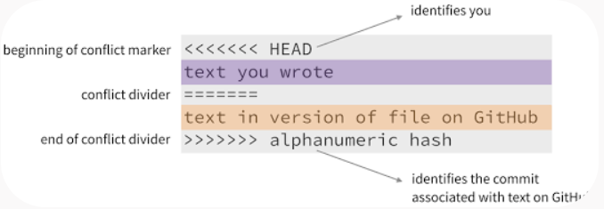

# Perguntas de Fixação (Git — Clone Aninhado, Push, Merge e Conflitos)

## 1. O que acontece tecnicamente quando um aluno clona um repositório Git dentro de outra pasta que já possui um arquivo `.git` oculto? Quais problemas isso pode causar no rastreamento de arquivos?

Tendo os dois `.git`, a rastreabilidade se perde e entra em confusão, quebrando o funcionamento do versionamento — por isso existem até estratégias para verificar se já existe um `.git`, como utilizar o `git status`.

Como o repositório pai já tem seu próprio `.git`, ele detecta que a pasta interna contém um `.git` independente e passa a tratá-la como um **submódulo não rastreado** (ou um *nested repository*).

---

## 2. Explique o motivo técnico pelo qual o Git rejeita um `git push origin develop` com a mensagem *non-fast-forward* quando outro membro da equipe realizou um push momentos antes.

Ocorre porque existem duas versões de desenvolvimento: quando um usuário faz o push, o segundo usuário não possui as novas alterações — o histórico remoto do Git já tem informações que a versão local dele não possui.

**A solução:** `git pull origin develop`, antes de tentar novamente — isso traz as mudanças do colega e permite que o Git decida se mescla automaticamente ou se há conflito.

---

## 3. Por que no GitFlow utilizamos a flag `--no-ff` ao mesclar uma branch `feature/*` na `develop`, em vez de realizar um merge padrão por *fast-forward*?

Retomando o que foi explicado na aula 03 — **preservação da história e do contexto:** sem a flag `--no-ff`, se a `develop` não tiver recebido nenhum outro commit enquanto a feature estava sendo programada, o Git realiza um merge por *fast-forward*, ou seja, apenas move o ponteiro da `develop` para o último commit da feature. Isso faz com que os commits da feature fiquem misturados em linha reta na `develop`, apagando o registro visual de que aquela funcionalidade existiu como uma branch separada.

---

## 4. Descreva o significado de cada uma das três partes geradas pelo Git dentro de um arquivo em conflito

**`<<<<<<< HEAD` até `=======`:**
Representa o código existente na sua branch atual (local/destino) — onde você está posicionado no momento em que tentou mesclar (ex.: as alterações da sua branch `develop`).

**`=======` (divisor):**
É a linha separadora horizontal. Indica a fronteira exata entre os dois códigos concorrentes que o Git não conseguiu resolver sozinho.

**`=======` até `>>>>>>> [hash-do-commit]`:**
Representa o código vindo da branch que está sendo integrada (origem/remota), identificada pelo hash do commit ou nome da branch (ex.: as alterações vindas da branch `feature/*`).