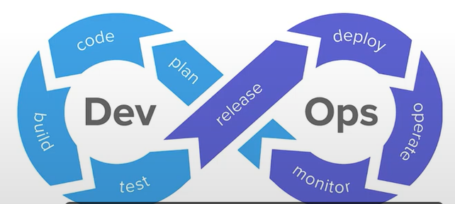

# Integração Contínua (CI) na Prática

Este guia explica o que é a **Integração Contínua (CI)**, como funciona o pipeline automatizado que roda a cada alteração de código e como a segurança entra nesse processo desde o início.



## Sumário

- [1. O que é Integração Contínua](#1-o-que-e-integracao-continua)
- [2. Como o pipeline de CI funciona](#2-como-o-pipeline-de-ci-funciona)
- [3. Complemento essencial: segurança no dia a dia](#3-complemento-essencial-seguranca-no-dia-a-dia)
- [4. Análise estática de código (SAST)](#4-analise-estatica-de-codigo-sast)
- [5. Testes automatizados de segurança em cada build](#5-testes-automatizados-de-seguranca-em-cada-build)
- [Resumo](#resumo)

## 1. O que é Integração Contínua

A **Integração Contínua** é uma prática fundamental da engenharia de software em que os desenvolvedores **integram suas alterações de código em um repositório central compartilhado várias vezes ao dia**.

O objetivo principal é **detectar e resolver conflitos de integração logo no início**, em vez de acumular problemas complexos até o final do ciclo de desenvolvimento.

Pense em uma equipe montando um quebra-cabeça: se cada pessoa encaixa suas peças a cada hora, qualquer erro aparece cedo e é fácil de corrigir. Se todas as peças só são encaixadas no fim da semana, descobrir o problema fica muito mais difícil.

## 2. Como o pipeline de CI funciona

**Na prática:** cada **push** ou **Pull Request (PR)** enviado ao repositório central dispara automaticamente um processo chamado **pipeline de CI**. Ferramentas como **Jenkins**, **GitHub Actions** e **GitLab CI** podem gerenciar esse pipeline.

O pipeline executa as seguintes etapas, uma após a outra:

1. **Build da aplicação:** o código-fonte é compilado (quando necessário) e montado, para garantir que não há erros de sintaxe, dependências quebradas ou problemas óbvios de empacotamento.
2. **Testes automatizados (unitários e de integração):** o sistema roda uma bateria de testes pré-definida.
   - **Testes unitários** validam o funcionamento isolado de pequenos componentes, como funções e classes.
   - **Testes de integração** verificam se diferentes partes do sistema interagem corretamente entre si e com serviços externos, como bancos de dados e APIs.
3. **Análise de qualidade e segurança:** ferramentas analisam o código para identificar:
   - **vulnerabilidades de segurança**, pela análise estática (**SAST**);
   - **problemas de qualidade de código** e **potenciais bugs**;
   - **falhas em bibliotecas de terceiros**, pela análise de composição de software (**SCA**).

> **Regra de ouro:** se o pipeline falhar em qualquer etapa, o **merge** (mesclagem) é **bloqueado automaticamente** e a equipe é notificada imediatamente. Se passar, o código é integrado à **branch principal**.

## 3. Complemento essencial: segurança no dia a dia

**Shift Left (segurança desde o início):** tratar ameaças e configurações inseguras cedo, com modelagem de ameaças, *pre-commit hooks* e análise de código e dependências antes do merge. Corrigir um problema nessa fase é mais barato e rápido.

Os principais tipos de varredura automatizada no pipeline são:

| Tipo | O que faz | Exemplo de alvo |
|---|---|---|
| **SAST** | Analisa o código-fonte sem executar a aplicação | Código da aplicação |
| **SCA** | Verifica vulnerabilidades em bibliotecas e dependências de terceiros | Pacotes npm, Maven, Composer |
| **Secret Scanning** | Detecta credenciais, chaves de API e tokens expostos | Código e histórico do Git |
| **DAST / IaC Scan** | Testa a aplicação em execução e verifica arquivos de infraestrutura | Terraform, Dockerfiles, Kubernetes |

**Policy as Code e gestão de vulnerabilidades:** são regras automatizadas que **bloqueiam o pipeline** diante de falhas críticas (os chamados *quality gates*) e priorizam as correções com base no **risco real** e na **exposição em produção**.

## 4. Análise estática de código (SAST)

A **análise estática** lê o código **antes da execução** para encontrar padrões inseguros, como **SQL Injection** ou segredos fixos no código (*hardcoded*).

### Exemplo em código: vulnerável vs. corrigido

Em Java:

```java
// VULNERÁVEL: concatenação direta da entrada do usuário na query SQL (SAST aponta SQL Injection)
String sqlVulneravel = "SELECT id, email FROM users WHERE email = '" + emailInput + "'";
Statement stmt = conn.createStatement();
ResultSet rs = stmt.executeQuery(sqlVulneravel);

// SEGURO: uso de PreparedStatement com parâmetro vinculado
String sqlSeguro = "SELECT id, email FROM users WHERE email = ?";
PreparedStatement ps = conn.prepareStatement(sqlSeguro);
ps.setString(1, emailInput);
ResultSet rsSeguro = ps.executeQuery();
```

### Fluxo visual: análise estática no ciclo de código

```plaintext
[Dev escreve código]
        │
        ▼
[Commit / Pull Request]
        │
        ▼
[Scanner SAST lê AST / regras de segurança]
        │
        ├── Falha crítica encontrada? ──► [Bloqueia PR + aponta linha e regra]
        │
        └── Sem falhas críticas? ──────► [Aprova merge para próxima etapa]
```

## 5. Testes automatizados de segurança em cada build

Em cada build do CI/CD, o pipeline executa **verificações automáticas rápidas**, como testes de segurança de endpoints, de dependências e de regras de acesso. O objetivo é detectar **regressões** (quando algo que funcionava deixa de funcionar ou de ser seguro) antes que o código avance.

### Exemplo em código: teste que verifica bloqueio de acesso não autorizado

Em Python:

```python
def test_endpoint_administrativo_exige_autenticacao(client):
    # Simula requisição sem token de autenticação a uma rota sensível
    resposta = client.get("/api/admin/usuarios")

    # Garante que o build falhe se a rota ficar aberta ou retornar dado indevido
    assert resposta.status_code in (401, 403)
    assert "senha" not in resposta.text.lower()
```

### Fluxo visual: execução em cada build

```plaintext
[Push na branch / Build disparado]
        │
        ▼
[Build da aplicação + Testes unitários]
        │
        ▼
[Testes automatizados de segurança (Auth, Input, Dependências)]
        │
        ├── Algum teste falha? ──────► [Build quebra (exit code != 0) -> Notifica equipe]
        │
        └── Todos passam? ───────────► [Gera artefato / segue no pipeline]
```

## Resumo

| Conceito | Ideia central |
|---|---|
| **CI** | Integrar o código ao repositório central várias vezes ao dia |
| **Pipeline de CI** | Build, testes automatizados e análise de segurança a cada push ou PR |
| **Bloqueio automático** | Falha em qualquer etapa impede o merge |
| **Shift Left** | Tratar segurança o quanto antes, quando corrigir é mais barato |
| **SAST** | Análise estática do código sem executá-lo |
| **SCA** | Verificação de vulnerabilidades em dependências de terceiros |
| **Testes de segurança no build** | Detectar regressões de autenticação e acesso antes de avançar |

**Pontos principais:**

- A **CI** integra o código com frequência para evitar conflitos acumulados.
- Cada **push** ou **PR** dispara o pipeline automaticamente.
- Uma falha em qualquer etapa **bloqueia o merge**.
- A **segurança** entra no pipeline por meio de SAST, SCA, Secret Scanning e DAST/IaC.
- Testes automatizados verificam, a cada build, se rotas sensíveis continuam protegidas.