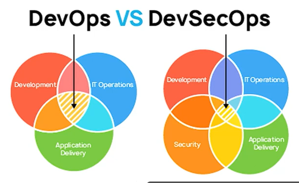
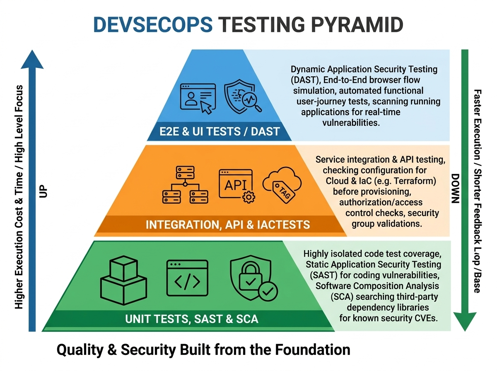

# DevSecOps: segurança integrada ao ciclo de entrega

Este guia explica o **DevSecOps**, a evolução do DevOps em que a **segurança** deixa de ser uma etapa isolada no final e passa a fazer parte de todas as fases do desenvolvimento de software.

## Sumário

- [1. Segurança em cada etapa do ciclo](#1-seguranca-em-cada-etapa-do-ciclo)
  - [Planejamento](#planejamento)
  - [Desenvolvimento](#desenvolvimento)
  - [Teste](#teste)
  - [Implantação](#implantacao)
  - [Operações](#operacoes)
- [2. DevOps vs. DevSecOps](#2-devops-vs-devsecops)
- [3. Pirâmide de testes DevSecOps](#3-piramide-de-testes-devsecops)
- [Resumo](#resumo)

## 1. Segurança em cada etapa do ciclo

Cada etapa do ciclo de vida do software recebe um ajuste de segurança. Veja como isso acontece em cada uma delas.

### Planejamento

**Ajuste:** no planejamento, o mapeamento é focado em identificar **riscos de segurança** do projeto, **requisitos regulatórios** e **modelagem de ameaças** antes de escrever o código.

**Exemplos práticos:**

- **Mapeamento de conformidade (ex.: LGPD):** verificar se o sistema armazenará dados sensíveis, como CPFs ou dados médicos, e planejar como eles serão criptografados.
- **Modelagem de ameaças (*Threat Modeling*):** antecipar invasões. Por exemplo: "E se alguém interceptar a API de pagamento?"
- **Definição de requisitos de segurança:** decidir logo no início o uso de **autenticação multifator (MFA)** ou de **políticas de senha forte**.

### Desenvolvimento

**Ajuste:** além da união para a arquitetura, é nesta etapa que o **código seguro** é criado no dia a dia.

**O que faltava (essencial):**

- **IDEs com análise em tempo real**, que ajudam o desenvolvedor a evitar vulnerabilidades enquanto digita.
- **Mapeamento de arquitetura de rede e de identidade** com o **princípio do menor privilégio**, definindo acessos mínimos para APIs e microsserviços.
- **Revisão de código (*Code Review*) focada em segurança** e uso de **pre-commit hooks**, que são bloqueios automáticos no Git para impedir que chaves ou senhas sejam salvas no repositório.

### Teste

**Ajuste:** embora os testes **E2E** e **unitários** sejam cruciais, o foco do DevSecOps é a **automação de testes voltados a vulnerabilidades** em pipelines rápidos de CI/CD.

**O que faltava (essencial):**

- **SAST e SCA:** varredura estática de vulnerabilidades e inspeção das dependências (bibliotecas externas), para evitar código com falhas conhecidas de terceiros.
- **DAST:** testes de segurança em tempo de execução no ambiente de testes, como uma simulação rápida de ataques, por exemplo, tentar injetar código na tela de login.

### Implantação

**Ajuste:** vai além de "colocar no ar para funcionar". O foco é garantir que o **ambiente de produção seja idêntico e seguro** ao testado, usando automação para reduzir erros humanos.

**O que faltava (essencial):**

- **Infraestrutura como Código (IaC) segura:** analisar automaticamente arquivos como Terraform ou Ansible em busca de **portas abertas indevidamente**.
- **Gerenciamento de segredos:** puxar chaves de API, senhas e certificados de **cofres de segredos**, como o HashiCorp Vault, em vez de deixá-los expostos no ambiente ou no código.
- **Deploy com risco mínimo:** estratégias como **Canary Release** ou **Blue-Green**, que fazem a atualização gradualmente e permitem reverter caso a segurança seja comprometida.

### Operações

**Ajuste:** no DevSecOps, as operações incluem o **monitoramento de ameaças em tempo real** (*SecOps*) e a **resposta automatizada** a novos riscos depois que o sistema está no ar.

**O que faltava (essencial):**

- **Detecção de intrusões e incidentes:** ferramentas que monitoram tráfego incomum ou tentativas de invasão constantes.
- **Feedback loops:** se a operação detectar que uma biblioteca ficou obsoleta ou que surgiu uma nova falha de segurança (um **dia zero**), essa informação volta **imediatamente** para o planejamento.

## 2. DevOps vs. DevSecOps

O diagrama de Venn compara os dois modelos.

**DevOps (à esquerda):** mostra a colaboração entre **Development** (Desenvolvimento) e **IT Operations** (Operações de TI), unidos para a entrega veloz do produto (**Application Delivery**). No centro, a prioridade é a **agilidade** e a **automação dos lançamentos**. Nesse modelo, a segurança costumava ser um processo isolado, executado por uma **equipe separada apenas no final do ciclo**, o que gerava retrabalho e atrasos.

**DevSecOps (à direita):** adiciona o quarto círculo, **Security** (Segurança), com a mesma importância dos outros três. A segurança deixa de ser o último obstáculo ou uma equipe isolada e passa a fazer parte de todas as fases da entrega de software. O objetivo é que **todos na equipe compartilhem a responsabilidade pela segurança**, automatizando processos e detectando falhas enquanto o produto é planejado e codificado, o chamado ***Shift Left***.

| Aspecto | DevOps | DevSecOps |
|---|---|---|
| Áreas envolvidas | Development, IT Operations e Application Delivery | Development, IT Operations, Security e Application Delivery |
| Papel da segurança | Processo isolado, geralmente no final | Integrada em todas as fases |
| Responsabilidade | Dividida entre equipes separadas | Compartilhada por toda a equipe |
| Momento de detecção de falhas | Tarde no ciclo | Cedo, durante planejamento e codificação (*Shift Left*) |

## 3. Pirâmide de testes DevSecOps

A pirâmide mostra como organizar a execução dos testes de forma equilibrada. A **base** concentra testes rápidos e baratos, com ampla cobertura de segurança. O **topo** reserva os testes mais caros e pesados, como os E2E e o DAST.

Pense na pirâmide como uma escada de custo e tempo: quanto mais alto o nível, maior o custo e o tempo de execução, mas também maior o foco em comportamento real do sistema.

| Nível | Tipos de teste | O que verifica |
|---|---|---|
| **Topo** | E2E e UI, DAST | Simulação de fluxos no navegador, jornadas de usuário e vulnerabilidades em tempo real na aplicação em execução |
| **Meio** | Integração, API e IaC | Integração entre serviços e APIs, configuração de nuvem e IaC antes do provisionamento, controle de acesso e validações de grupos de segurança |
| **Base** | Testes unitários, SAST e SCA | Cobertura de código isolado, vulnerabilidades no código (SAST) e falhas conhecidas em dependências de terceiros (SCA, CVEs) |

Em resumo, a base é a mais rápida e a que dá o **feedback mais curto**, enquanto o topo é a mais cara e a que verifica o sistema de forma mais completa. O lema da pirâmide é: **qualidade e segurança são construídas desde a base**.

## Resumo

| Etapa | Ajuste de segurança principal |
|---|---|
| Planejamento | Riscos, requisitos regulatórios e modelagem de ameaças |
| Desenvolvimento | Código seguro, revisão focada em segurança e pre-commit hooks |
| Teste | SAST, SCA e DAST automatizados em pipelines rápidos |
| Implantação | IaC segura, gerenciamento de segredos e deploy com risco mínimo |
| Operações | Detecção de intrusões e feedback loops para o planejamento |

**Pontos principais:**

- O **DevSecOps** integra a segurança em todas as fases, e não apenas no final.
- A **responsabilidade pela segurança** é compartilhada por toda a equipe.
- O ***Shift Left*** antecipa a detecção de falhas, quando corrigir custa menos.
- A **pirâmide de testes** equilibra rapidez na base e cobertura completa no topo.