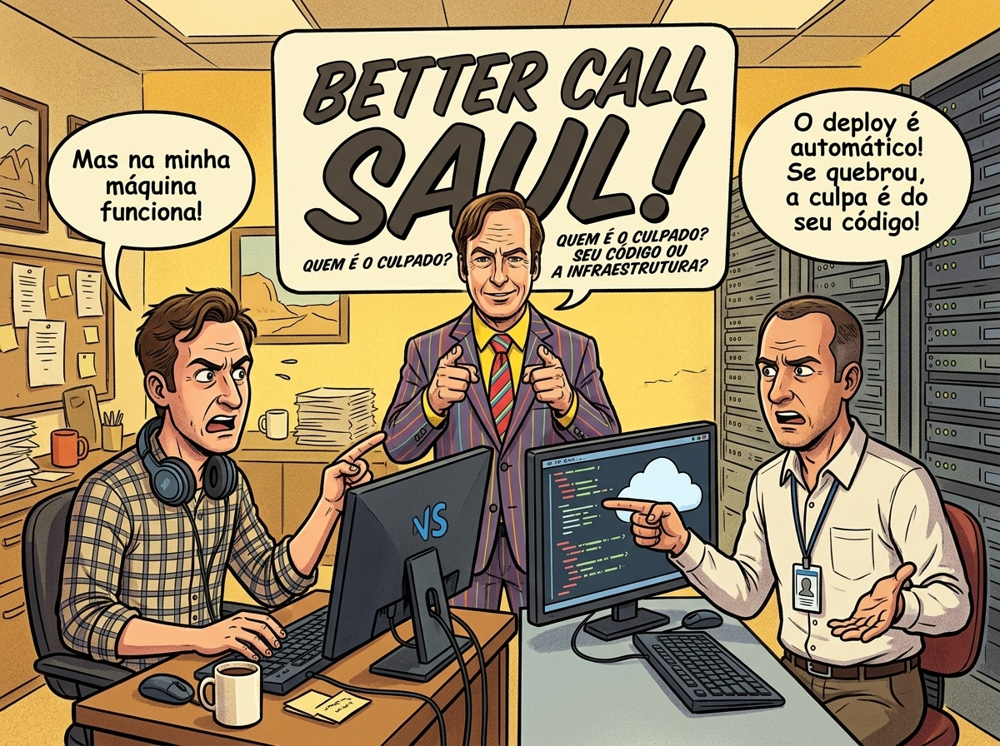

# De quem é a culpa? Entendendo o "na minha máquina funciona"

Este guia explica por que uma aplicação pode funcionar no computador do programador e quebrar na nuvem, e mostra como **padronizar o ambiente** e **encontrar a causa do problema** de forma organizada.

## Sumário

- [1. O cenário](#1-o-cenario)
- [2. De quem é a culpa?](#2-de-quem-e-a-culpa)
- [3. Como encontrar o culpado](#3-como-encontrar-o-culpado)
  - [3.1 Build e dependências](#31-build-e-dependencias)
  - [3.2 Configuração](#32-configuracao)
  - [3.3 Rede e contrato](#33-rede-e-contrato)
  - [3.4 Ambiente e runtime](#34-ambiente-e-runtime)
  - [3.5 Dados](#35-dados)
- [4. Ferramentas para padronizar o ambiente](#4-ferramentas-para-padronizar-o-ambiente)
  - [Docker](#docker)
  - [Migrations](#migrations)
  - [Infraestrutura como Código (IaC) e pipeline de CI/CD](#infraestrutura-como-codigo-iac-e-pipeline-de-cicd)
- [Resumo](#resumo)

## 1. O cenário

Imagine a seguinte situação:

1. O **programador** desenvolve a aplicação em casa, com a sua versão do VS Code, do Java e do React, e envia o código para o **operacional**.
2. O **operacional** sobe a aplicação na nuvem, mas uma funcionalidade que funcionava antes **desapareceu**.

Surge então a pergunta: **quem é o culpado?**

## 2. De quem é a culpa?

Na ilustração, o programador diz **"Mas na minha máquina funciona!"**, enquanto o operacional responde que **"o deploy é automático, e se quebrou, a culpa é do seu código!"**.

A resposta curta e técnica é: **de ninguém e de ambos**.

- O **programador** não mentiu. No ambiente dele, com uma versão específica do Java, do React e de variáveis locais, a aplicação realmente funcionava.
- O **operacional** também não mentiu. A automação fez exatamente o que foi programada para fazer.

O verdadeiro "culpado" é a **falta de padronização** e a **ausência de comunicação** entre as duas áreas. O problema não está em uma pessoa, e sim na forma como o ambiente foi montado.

Por isso, a pergunta mais útil não é "quem errou?", e sim: **"quais diferenças existem entre o ambiente que funciona e o que quebrou?"**.

## 3. Como encontrar o culpado

Quando algo quebra, **não mexa primeiro no Docker ou no banco de dados**. Siga esta ordem de eliminação, da camada mais externa para a mais interna:

1. **Build e dependências:** os lockfiles são idênticos?
2. **Configuração:** as variáveis de ambiente e as permissões na nuvem batem com as locais?
3. **Rede e contrato:** o frontend consegue falar com o backend (CORS, URL e formato do JSON)?
4. **Ambiente e runtime:** a versão do Java ou do Node e o sistema operacional batem? (é aqui que entra o Docker)
5. **Dados:** a estrutura do banco está sincronizada? (é aqui que entram as Migrations)

### 3.1 Build e dependências

Mesmo sem Docker, o projeto pode quebrar se o Java (Maven ou Gradle) ou o React (npm, yarn ou pnpm) instalarem **versões diferentes de sub-dependências** na máquina do dev e no servidor de build.

**Por que quebra:** arquivos como o `package.json` usam prefixos como `^1.2.0` ou `~1.2.0`, que permitem instalar atualizações menores automaticamente. Se uma biblioteca externa lançar uma versão com bug entre ontem e hoje, o servidor baixa a versão quebrada, enquanto a sua máquina continua com a antiga em cache.

**Como perceber:** o erro aparece na etapa de build ou compilação, com mensagens como `NoSuchMethodError` ou `TypeError` em uma biblioteca de terceiros, sem que ninguém tenha mexido naquele trecho do código.

**Como evitar:**

- Versionar sempre o arquivo de trava no Git (`package-lock.json`, `yarn.lock`, `pnpm-lock.yaml` ou `gradle.lockfile`).
- No pipeline e no servidor, usar comandos estritos que instalam exatamente o que está travado, como `npm ci` em vez de `npm install`.

### 3.2 Configuração

O código é exatamente o mesmo, mas o comportamento muda porque a **configuração do ambiente** mudou.

**Por que quebra:**

- Uma funcionalidade nova está protegida por uma **feature flag** (uma chave que liga ou desliga recursos), que estava ativa no seu PC, mas na nuvem está desligada.
- Chaves de API externas (pagamento, envio de e-mail, autenticação) estão expiradas, com limite excedido ou apontando para o ambiente de teste (*sandbox*) em vez do de produção.

**Como perceber:** o sistema não exibe tela de erro, mas uma funcionalidade específica não aparece ou retorna erro de autorização (401 ou 403) ao falar com serviços externos.

**Como evitar:**

- **Fail-fast (falhar rápido):** programar a aplicação para verificar todas as variáveis obrigatórias assim que inicia. Se faltar alguma configuração, ela se recusa a subir e registra no log exatamente qual variável está faltando.
- Manter um arquivo `.env.example` sempre atualizado no repositório, servindo como documentação viva de tudo o que o sistema precisa para rodar.

### 3.3 Rede e contrato

No seu cenário, uma funcionalidade "desapareceu" ao subir na nuvem. Muitas vezes o código subiu, mas a comunicação entre as partes falhou silenciosamente ou foi bloqueada.

**Por que quebra:**

- **CORS (*Cross-Origin Resource Sharing*):** localmente tudo roda em `localhost`, mas na nuvem o React pode estar em um domínio diferente da API, e o navegador bloqueia a requisição.
- **Quebra de contrato:** o backend muda o nome de um campo JSON (por exemplo, de `userName` para `username`), ou o formato de uma data, e o frontend continua esperando o formato antigo.
- **URLs fixas no código (*hardcoded*):** o frontend aponta para `http://localhost:8080` em vez de ler o endereço do ambiente.

**Como perceber:** a aplicação abre normalmente, mas botões não funcionam ou listas aparecem vazias. No DevTools do navegador (abas *Network* e *Console*), surgem erros como *CORS policy*, `404 Not Found` ou `502 Bad Gateway`.

**Como evitar:**

- Usar testes de contrato ou documentação automatizada, como OpenAPI ou Swagger, para validar se o JSON entregue pelo backend corresponde ao que o frontend consome.
- Configurar as políticas de CORS por variável de ambiente, desde o primeiro dia do projeto.

### 3.4 Ambiente e runtime

Aqui entram as versões do Java, do Node e do sistema operacional. Se elas forem diferentes entre a máquina do programador e a nuvem, o comportamento da aplicação pode mudar. É exatamente isso que o **Docker** resolve, como veremos na seção 4.

### 3.5 Dados

Se a estrutura do banco de dados local for diferente da estrutura da nuvem, o código tenta acessar uma coluna ou tabela que não existe, e o sistema quebra. As **Migrations** resolvem esse problema, como veremos na seção 4.

## 4. Ferramentas para padronizar o ambiente

Para evitar o "na minha máquina funciona", o mercado usa três práticas principais.

### Docker

Pense no Docker como um **contêiner de navio comercial**. O contêiner tem sempre o mesmo tamanho e formato, não importa o que está dentro dele, e cabe em qualquer navio ou caminhão.

**Como resolve o cenário:** com o Docker, o programador não envia apenas "o código Java e React". Ele escreve um arquivo chamado **`Dockerfile`**, que funciona como infraestrutura como código e diz, por exemplo: "para rodar esta aplicação, use o Linux na versão X, o Java na versão Y e o Node na versão Z. Copie o código e ligue o servidor".

**Na prática:** o programador roda a aplicação dentro desse contêiner na própria máquina. Quando envia o projeto, o operacional sobe exatamente o mesmo contêiner na nuvem. Se funcionou dentro do Docker na máquina do dev, deve funcionar da mesma forma na nuvem, porque o ambiente é idêntico.

**Atenção:** o Docker resolve a padronização, mas não garante que o código esteja correto. Ele também precisa ser configurado com cuidado. Um problema comum é não configurar os **volumes**, que compartilham arquivos entre a máquina e o contêiner. Sem eles, ao alterar o código no VS Code, o Docker pode não perceber a mudança, ou a porta do sistema pode não ficar acessível. Por isso, Dev e Ops devem trabalhar juntos para que o Docker local seja fácil de usar para depurar.

### Migrations

Sem Migrations, o desenvolvedor cria uma tabela `clientes` com o campo `telefone` no banco local. Ao enviar o código para a nuvem, a aplicação tenta salvar o telefone, mas o banco da nuvem não foi atualizado e não tem esse campo. O sistema quebra.

**Como resolve:** as Migrations são arquivos de código que descrevem as mudanças do banco, por exemplo: "crie a tabela `clientes` com a coluna `telefone`". Esses arquivos são versionados no Git junto com o restante do projeto.

**Na prática:** quando a aplicação sobe, local ou na nuvem, ela lê as Migrations e atualiza o banco automaticamente para o estado exato que o código precisa. Ninguém cria tabelas manualmente.

### Infraestrutura como Código (IaC) e pipeline de CI/CD

Para evitar que o operacional configure a nuvem "de cabeça", ou seja, manualmente no painel, tudo é escrito em arquivos de configuração, como **Terraform**, **Ansible** ou o próprio `docker-compose`.

Se a versão do Java for atualizada, a mudança não acontece de surpresa. O programador altera a versão no `Dockerfile` e envia para o Git. Então o **pipeline de CI/CD**:

1. lê essa mudança;
2. roda os testes de segurança e de integração em um ambiente temporário automático;
3. libera o envio para a nuvem somente se os testes comprovarem que a nova versão do Java não quebrou nada.

**Importante:** a nova versão do Java nunca é atualizada diretamente em produção. Ela é atualizada primeiro no código, testada pelo pipeline e, se quebrar algo, bloqueada antes de afetar os usuários.

## Resumo

| Camada | Pergunta a fazer | Prática que ajuda |
|---|---|---|
| Build e dependências | Os lockfiles são idênticos? | Versionar o lockfile e usar `npm ci` |
| Configuração | As variáveis e permissões batem? | Fail-fast e `.env.example` |
| Rede e contrato | O frontend fala com o backend? | Testes de contrato, OpenAPI e CORS configurado |
| Ambiente e runtime | As versões são as mesmas? | Docker com `Dockerfile` versionado |
| Dados | O banco está sincronizado? | Migrations versionadas no Git |

**Pontos principais:**

- O problema do "na minha máquina funciona" costuma ser **falta de padronização**, não a culpa de uma pessoa.
- Antes de mexer no Docker ou no banco, verifique as **camadas em ordem**: build, configuração, rede e contrato, ambiente e dados.
- O **Docker** padroniza o ambiente, as **Migrations** padronizam o banco e a **IaC com CI/CD** garante que as mudanças sejam testadas antes de chegar aos usuários.